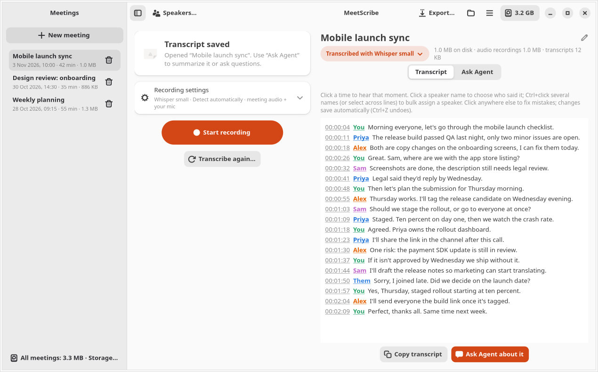
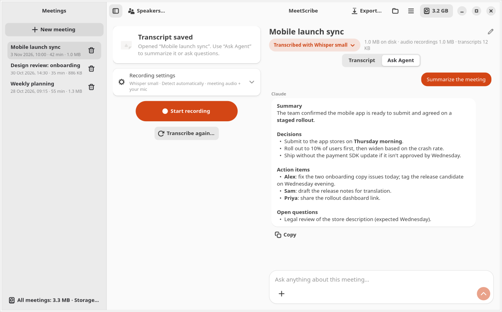
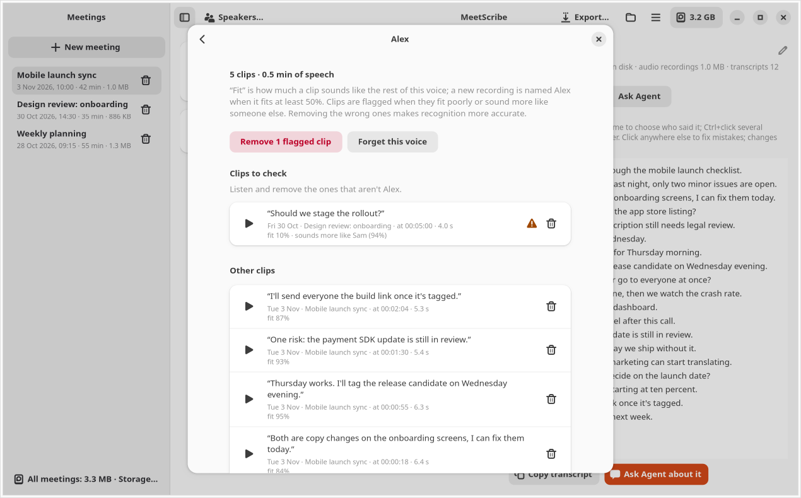
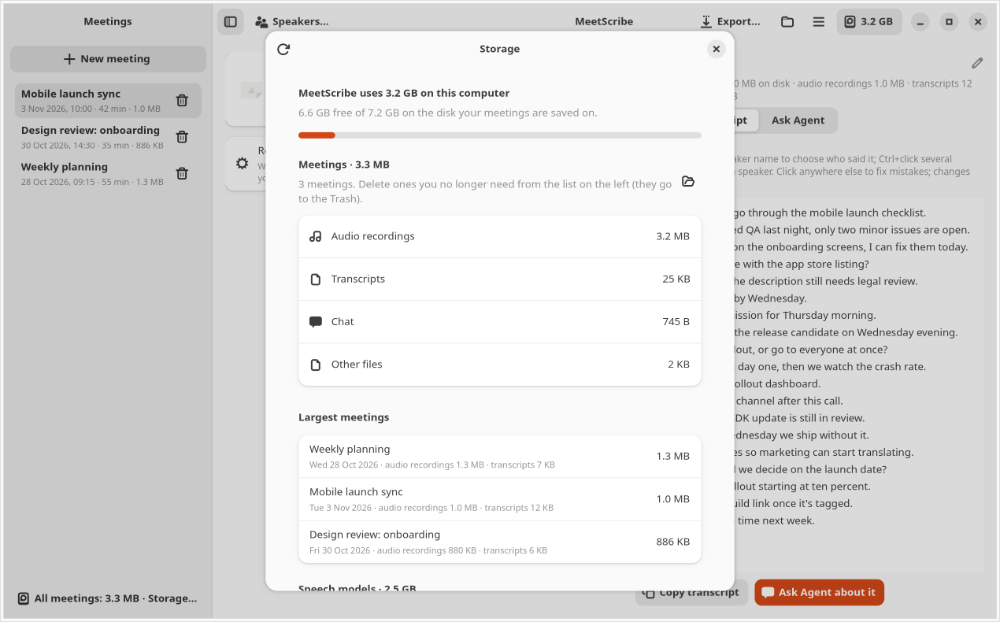

# MeetScribe

**Record and transcribe your meetings on your own computer, then ask Claude about them.**

MeetScribe is a Linux desktop app (GTK 4 / libadwaita) that records what you hear in a call and what you
say into your microphone, transcribes both live with a local speech model, tells the speakers apart, and
learns their voices so it can name them in later meetings. When the call ends you can ask questions about
it, get a summary or a follow-up email, and export it as Word, PDF, Markdown or one clean audio file.

It works with any call app (Zoom, Google Meet, Teams, Slack, Discord, Lark, a browser tab…) because it
records your computer's audio output instead of joining the call. Nothing is uploaded: the audio never leaves
your computer.

[](LICENSE)




## Features

- **Live transcription, fully local.** Choose Parakeet (fast, English + 24 European languages) or Whisper
  small / medium (about 100 languages, including Urdu, Arabic, Hindi and Chinese). You can switch models in
  the middle of a meeting without losing anything.
- **Who said what.** Your microphone is always labelled *You*. Other voices are told apart and named
  automatically once MeetScribe has learned them.
- **Fix speakers quickly.** Click a name to change it, *Replace all* for every line of a detected speaker,
  or Ctrl+click / Shift+click / select several lines and **bulk assign** them at once. One Ctrl+Z undoes it.
- **Review learned voices.** See every clip a person's voice was learned from, listen to them, and remove the
  ones that are someone else. Clips that sound like another person are flagged for you.
- **Ask Agent.** Chat with Claude about the meeting: summaries, decisions, action items with owners, follow-up
  emails. Uses your own Claude subscription through [Claude Code](https://docs.anthropic.com/en/docs/claude-code).
- **Click a timestamp to hear that moment**, add bookmarks during the call (Ctrl+B), and edit the transcript
  in place (changes save automatically).
- **Transcribe again** with another model later. Earlier transcripts are kept as versions you can open and
  restore.
- **Export** to Word, PDF or Markdown (summary, chat, bookmarks, transcript), or **one mixed MP3** of the
  whole call with background noise removed and voices evened out.
- **Know what it costs.** A live CPU / memory panel while transcribing, and an optional disk-usage view for
  every meeting, model and file, with warnings before storage gets out of hand.
- **Stays out of the way.** Tray icon, optional start at log-in, and a prompt when a call app starts using
  your microphone.

| Ask Agent | Learned voices | Storage |
|---|---|---|
|  |  |  |

*Screenshots use an invented demo meeting.*

## Requirements

- **Linux with PipeWire or PulseAudio** (the default on current Ubuntu, Fedora and Debian).
- **GTK 4 and libadwaita 1.6+ for Python**: Ubuntu 25.04+, Fedora 41+, Debian 13+, Arch.
- **x86_64 or ARM64**, about **1.5 GB of disk** for the app and the Parakeet model (+0.5 GB for Whisper small,
  +1.5 GB for Whisper medium, downloaded when first used).
- A CPU with 4+ cores is plenty for Parakeet; Whisper live transcription is comfortable on 8 cores.
- Optional: **[Claude Code](https://docs.anthropic.com/en/docs/claude-code)**, signed in, for Ask Agent and
  summaries.
- Optional on GNOME: the **AppIndicator and KStatusNotifierItem** extension, to show the tray icon
  (pre-installed on Ubuntu).

Install the system packages first:

```bash
# Ubuntu / Debian
sudo apt install python3-gi gir1.2-gtk-4.0 gir1.2-adw-1 pulseaudio-utils ffmpeg curl
# Fedora
sudo dnf install python3-gobject gtk4 libadwaita pulseaudio-utils ffmpeg curl
# Arch
sudo pacman -S python-gobject gtk4 libadwaita libpulse ffmpeg curl
```

## Install

```bash
git clone https://github.com/OWNER/meetscribe.git
cd meetscribe
./install.sh
```

No sudo is needed. The installer puts a private Python 3.12 with the speech engines in
`~/.local/share/meetscribe`, downloads the Parakeet and speaker-recognition models (about 680 MB), adds the
`meetscribe` command to `~/.local/bin` and an entry to your app menu.

To update, `git pull` and run `./install.sh` again (quit MeetScribe from its tray menu first, and never in the
middle of a recording). To remove it, run `./uninstall.sh`. Your meetings and settings are kept unless you add
`--purge`.

## Using it

1. **Before a call**, open MeetScribe and press **Start recording**. Wear headphones if you can: on speakers,
   your mic also hears the call.
2. **During the call** the transcript appears as people speak. Click a speaker name to say who it is; from
   then on that voice is named automatically, in this meeting and in future ones.
3. **After the call**, open **Ask Agent** and pick a suggestion such as *Summarize the meeting*, or type your
   own question (Enter sends, Shift+Enter starts a new line).
4. **Export** from the header bar, or click **Transcribe again** to try another model on the saved audio.

Add the people you meet with under **Speakers…** (name and optional email; the agent uses emails for
follow-ups). Review and clean up their learned voices from **☰ → Learned voices…**.

### Which speech model?

| Model | Languages | Live CPU use | Download |
|---|---|---|---|
| **Parakeet TDT 0.6B v3** (default) | English + 24 European, auto-detected | ~2 cores | 640 MB (at install) |
| **Whisper small** | ~100 | ~4 cores, about 5× faster than speech on a typical 8-core laptop | 460 MB |
| **Whisper medium** | ~100, more accurate | ~4 cores, about 2× faster than speech; may lag in long monologues | 1.5 GB |

For other languages, set **Meeting language** in the recording settings rather than relying on detection.

### Command line

```bash
meetscribe                         # open the window (--background: start in the tray)
meetscribe record                  # record from the terminal, Ctrl+C to stop
meetscribe record --engine whisper --model medium --language ur --live
meetscribe file interview.mp4      # transcribe an existing audio or video file
meetscribe summarize ~/MeetScribe/2026-11-03_100000
meetscribe --version
```

`meetscribe record --help` lists every option.

## Your data and privacy

- **Audio and transcripts stay on your computer**, in `~/MeetScribe/<date_time>/`: two audio files (the call
  and your mic), the transcript, earlier transcript versions, the chat and your bookmarks.
- **Speakers, learned voices and settings** are in `~/.config/meetscribe/`. A learned voice is a list of short
  numeric voiceprints plus the words of each clip, not audio.
- **Network use:** the installer and first use of a model download from GitHub and Hugging Face. **Ask Agent**
  and `meetscribe summarize` send the meeting's *transcript text* (never audio) to Anthropic through your Claude
  Code login. Claude runs with all tools disabled, so it can only read the transcript it's given. Nothing else
  is sent anywhere, and there is no telemetry.

**Recording consent.** Laws on recording conversations differ between countries and states, and many require
everyone's consent. Tell the people in your meetings that you're recording and transcribing, and follow your
organisation's policies.

## Troubleshooting

- **"No meeting audio yet"**: the call must play through your computer's default speakers or headphones.
  Check the output device in your system sound settings (and in the call app), then try again.
- **Your words also appear as "Them"**: you're on speakers and the mic is hearing the call. Use headphones.
- **No tray icon on GNOME**: install and enable the *AppIndicator and KStatusNotifierItem* extension.
- **Ask Agent says it can't find Claude**: install Claude Code, run `claude` once in a terminal to sign in,
  and make sure `claude` is on your `PATH`.
- **Something else**: errors from the window are in the system journal:
  `journalctl --user -t gui.py --since today`. Please include them when you
  [report a bug](../../issues/new/choose).

## Contributing

Bug reports, ideas and pull requests are welcome. See [CONTRIBUTING.md](CONTRIBUTING.md) for how to run it
from source and run the tests, [docs/ARCHITECTURE.md](docs/ARCHITECTURE.md) for how it fits together, and
[docs/ROADMAP.md](docs/ROADMAP.md) for planned features. Please follow the
[Code of Conduct](CODE_OF_CONDUCT.md), and report security issues as described in [SECURITY.md](SECURITY.md).

## License and credits

MeetScribe is released under the [MIT License](LICENSE). © 2026 Saailverse Technologies.

It builds on excellent open-source work, downloaded at install time under their own licenses:

- [Parakeet TDT 0.6B v3](https://huggingface.co/nvidia/parakeet-tdt-0.6b-v3) by NVIDIA (CC-BY-4.0), in the
  [sherpa-onnx int8 conversion](https://huggingface.co/csukuangfj/sherpa-onnx-nemo-parakeet-tdt-0.6b-v3-int8)
- [sherpa-onnx](https://github.com/k2-fsa/sherpa-onnx) by k2-fsa (Apache-2.0)
- [Whisper](https://github.com/openai/whisper) by OpenAI (MIT), run with
  [faster-whisper](https://github.com/SYSTRAN/faster-whisper) by SYSTRAN (MIT)
- [ERes2Net speaker model](https://github.com/modelscope/3D-Speaker) from 3D-Speaker (Apache-2.0)
- [python-docx](https://github.com/python-openxml/python-docx) (MIT), [fpdf2](https://github.com/py-pdf/fpdf2)
  (LGPL-3.0), [uv](https://github.com/astral-sh/uv) (MIT / Apache-2.0)
- [GTK](https://gtk.org), [libadwaita](https://gitlab.gnome.org/GNOME/libadwaita) and
  [PyGObject](https://pygobject.gnome.org) (LGPL), [FFmpeg](https://ffmpeg.org) (LGPL / GPL)

MeetScribe is not affiliated with Anthropic, NVIDIA, OpenAI or any call app.
